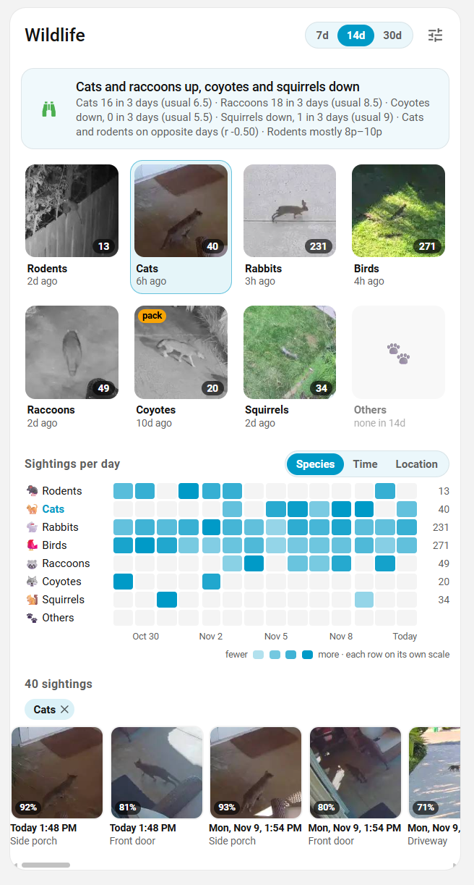
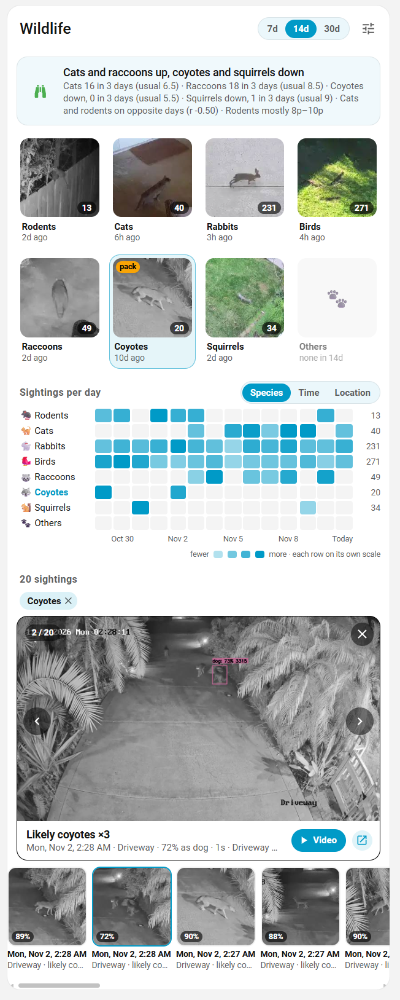

# Wildlife Card

A Home Assistant dashboard card for the animals your [Frigate](https://frigate.video) cameras see. It answers the questions a wildlife notification never does: **is this unusual, where is it happening, and is it getting worse?**



*Fourteen days on a working installation. The Cats tile is selected, so the grid and the browser below it show cats only.*

- **A headline that reads the trend, not the last event.** Which animals are running above or below their own usual rate over the last three days, the numbers behind it, where and when rodents concentrate, and whether cat activity tracks rodent activity day to day.
- **One tile per species**, each showing the best-scoring recent picture, a count for the period and how long ago the last sighting was. Tap one and the sightings browser shows that species alone — and so does the grid, once you switch it to Time or Location.
- **An activity grid** of days across by species, two-hour block, or camera — so a spate, a nightly pattern or one bad corner of the property stands out. Tap any cell to see just those sightings. The time-of-day view is shaded for daylight, darkness, dawn and dusk, each column by its own date.
- **A sightings browser**: a filmstrip newest-first, a full snapshot with previous/next, and the clip for any sighting that has one.
- **A confidence filter**, tucked behind the tune icon, to screen out the misclassifications every model produces.
- **Coyotes without a coyote label.** Frigate+ does not detect coyotes yet, so the card can infer them: a dog on chosen cameras late at night with no person nearby, and two overlapping tracks flagged as a pack.
- **No helper entities.** The card reads tracked objects straight from the Frigate integration over its websocket API. There is nothing to add to `configuration.yaml`.

## Requirements

- [Frigate](https://frigate.video) and the [Frigate integration](https://github.com/blakeblackshear/frigate-hass-integration) for Home Assistant.
- Animal labels in your Frigate `objects → track` list. Most of them (`rodent`, `rabbit`, `raccoon`, `squirrel`, `fox`, `skunk`, `possum`) come from a [Frigate+](https://frigate.video/plus) model; `bird`, `cat` and `dog` are in the default model as well.

## Install

**HACS:** HACS → ⋮ → *Custom repositories* → add `https://github.com/FortranFour/wildlife-card` as type **Dashboard**, then install *Wildlife Card*. HACS adds the resource `/hacsfiles/wildlife-card/wildlife-card.js`.

**Manual:** download every file attached to the [latest release](https://github.com/FortranFour/wildlife-card/releases) into `/config/www/wildlife-card/`, then add `/local/wildlife-card/wildlife-card.js` as a JavaScript module resource. Keep the other file beside it — the card loads it the first time you play a clip.

## Add the card

Everything is optional:

```yaml
type: custom:wildlife-card
```

The same card with every option written out at its default, for dashboards where comments get stripped:

```yaml
type: custom:wildlife-card
title: Wildlife
icon: mdi:binoculars
instance_id: frigate
sun_shading: true
days: 14
min_score: 70
refresh: 300
indoor_cameras:
  - Attic
  - Crawlspace
coyote:
  enabled: true
  cameras:
    - Driveway
    - Front
  start: '23:00'
  end: '05:00'
  person_window: 120
```

Quote `start` and `end`. Unquoted, YAML reads `23:00` as a number and the night window is wrong.

## Options

| Option | Default | What it does |
|---|---|---|
| `title` | `Wildlife` | Card title. |
| `icon` | `mdi:binoculars` | Headline icon while nothing needs attention. An alert swaps in `mdi:alert-circle`. |
| `instance_id` | `frigate` | Your Frigate instance, which is its MQTT `client_id`. Only matters with more than one Frigate. |
| `days` | `14` | Range the card opens on: `7`, `14` or `30`. |
| `min_score` | `70` | Confidence filter the card opens on, in percent (50–99). |
| `refresh` | `300` | Seconds between background refreshes. Minimum 60. |
| `sun_shading` | `true` | Day/night shading behind the time-of-day rows. Needs a latitude and longitude set in Home Assistant; skipped if there is none. |
| `indoor_cameras` | `[Attic, Crawlspace]` | Cameras where a rodent is an alert rather than a sighting. |
| `coyote.enabled` | `true` | Infer coyotes from night-time dogs. See below. |
| `coyote.cameras` | `[Driveway, Front]` | Cameras the inference looks at. |
| `coyote.start` | `'23:00'` | Start of the night window. |
| `coyote.end` | `'05:00'` | End of the night window. |
| `coyote.person_window` | `120` | Seconds either side of a dog to look for a person. |
| `species` | the eight below | Replaces the built-in species list entirely. |

`days`, `min_score` and the grid's row mode are starting values. Once you use those controls the card remembers your choice in that browser, and the YAML no longer decides them.

The card is 12 columns wide by default and switches to a single row of tiles and a taller stage past 640px.

## Species

The default list, in tile order:

| id | Labels it collects | id | Labels it collects |
|---|---|---|---|
| `rodent` | `rodent` | `raccoon` | `raccoon` |
| `cat` | `cat` | `coyote` | `coyote` (plus the inference) |
| `rabbit` | `rabbit` | `squirrel` | `squirrel` |
| `bird` | `bird` | `other` | `fox`, `skunk`, `possum`, `snake` |

Give `species` to change the grouping — which animals get a tile of their own, what they are called, and the order they appear in:

```yaml
species:
  - id: rodent
    name: Rodents          # tile and row label
    one: Rodent            # how one sighting is named in the browser
    labels: [rodent]       # Frigate labels collected into this group
    glyph: 🐀              # tile icon (emoji: MDI has no fox or raccoon)
  - id: other
    name: Others
    one: Other
    labels: [fox, skunk, possum, snake]
    glyph: 🐾
```

Sightings in a multi-label group are still named individually in the browser, so a fox inside *Others* is labelled "Fox".

Three ids carry behaviour and are worth keeping: `rodent` drives the indoor alert and the location/time summary, `coyote` receives the inference, and `other` names its sightings by their own label rather than the group name.

## Coyotes without a coyote label

Frigate+ lists `coyote` as a *candidate* label: you can annotate one, but no model detects it yet. Meanwhile a coyote is usually detected as a dog.

So with `coyote.enabled`, the card treats a `dog` as a likely coyote when **all** of these hold:

1. it is on one of `coyote.cameras`,
2. it starts inside the night window, and
3. no `person` was tracked on those cameras within `coyote.person_window` seconds of it.

Two or more such tracks overlapping in time are flagged as a **pack**, which is the card's loudest alert. Inferred sightings are labelled "Likely coyote" everywhere, and their real confidence is shown as "72% as dog", so they are never confused with a detection.



*Three overlapping tracks at 2:28am with nobody about. Frigate called each one a dog; the snapshot still carries its `dog 72%` box.*

If the person lookup fails, the card infers nothing rather than guessing. Set `coyote.enabled: false` to switch the whole thing off, and if a model ever does detect `coyote`, those detections are picked up with no change needed.

## What the headline says

In order of precedence:

1. **A likely coyote pack** in the last 48 hours, or a **rodent on an indoor camera** in the last 3 days. Either turns the icon red.
2. Otherwise, **which species are above or below their usual rate** — the last 3 days against the rest of the selected range. A species is "up" at 3 or more sightings and at least 1.8× its usual rate, and "down" at half its usual rate or less.

The second line carries the evidence: counts against the usual rate for each flagged species, the cat–rodent correlation once each has 4 or more sightings (Pearson's r over daily counts; "tracking" at r ≥ 0.45, "opposite days" at r ≤ −0.45), and the camera and two-hour block most rodent sightings fall in.

On a 7-day range the baseline is only 4 days, so the flags are jumpier there than on 14 or 30.

## Notes and limits

- **History is bounded by Frigate's retention.** The card can only show what Frigate still holds, so the 30-day range is empty beyond your `record` and `snapshots` retention. Sightings older than your snapshot retention fall back to the thumbnail.
- **Clips play over HLS**, through [hls.js](https://github.com/video-dev/hls.js), using the event stream the Frigate integration serves from the same proxy. Apple's native player rejects recordings that hls.js plays without complaint, which is why Home Assistant's own media browser succeeds where a plain video element fails. The card tries hls.js, then the browser's own HLS, then the MP4, and says which way it failed if none of them work. hls.js is bundled as a separate file and fetched only when you first play a clip.
- **Images come from the integration's notification proxy.** If you have that switched off, the card retries through an authenticated signed path.
- **Corrections on the Frigate+ site do not reach events already stored.** Submitting and relabelling a snapshot trains a future model; it does not change the label on the sighting in the card. The confidence filter is the way to hide a misclassification.
- **Sub-labels are shown** when Frigate has one, so a classified bird reads "Bird · Dark Eyed Junco".

## Development

```bash
npm install
npm run build        # esbuild → dist/ (the card, plus hls.js as a lazy chunk)
node dev/test.mjs    # headless Chromium checks, screenshots in dev/out/
```

`dev/harness.html` renders the built card against generated events, with no Home Assistant and no real footage, so the card can be run and tested without a camera. Open it directly by serving the repo root. The checks cover the species tiles, the filters, each grid mode, the sightings browser and the coyote inference; CI keeps the screenshots as an artifact.

## Credits

Built for [Frigate](https://frigate.video) by Blake Blackshear and the [Frigate integration](https://github.com/blakeblackshear/frigate-hass-integration). MIT licensed.
