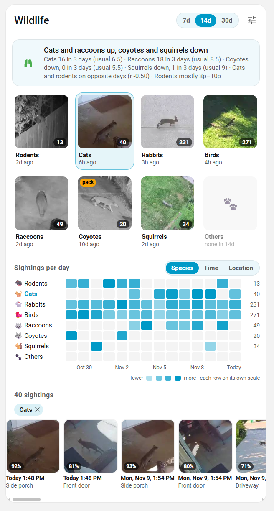
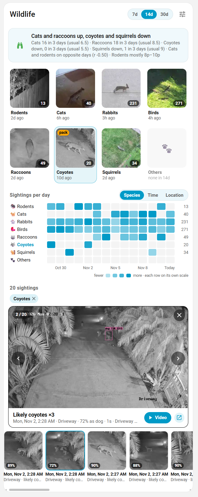
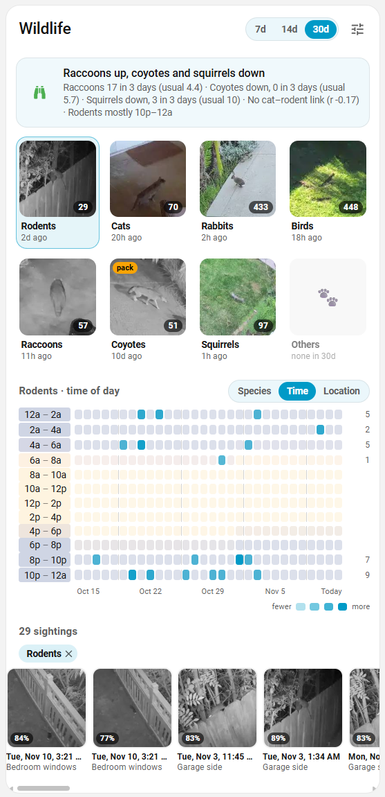
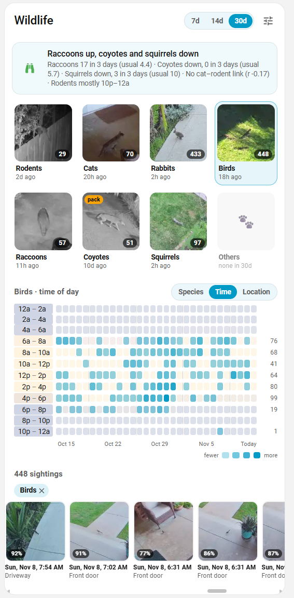

# Wildlife Card

A Home Assistant dashboard card for the animals your [Frigate](https://frigate.video) cameras see. It answers the questions a wildlife notification never does: **is this unusual, where is it happening, and is it getting worse?**



*Fourteen days on a working installation. The Cats tile is selected, so the grid and the browser below it show cats only.*

- **A headline that reads the trend, not the last event.** Which animals are running above or below their own usual rate over the last three days, the numbers behind it, where and when rodents concentrate, and whether cat activity tracks rodent activity day to day.
- **One tile per species**, each showing the best-scoring recent picture, a count for the period and how long ago the last sighting was. Tap one and the sightings browser shows that species alone — and so does the grid, once you switch it to Time or Location.
- **An activity grid** of days across by species, two-hour block, or camera — so a spate, a nightly pattern or one bad corner of the property stands out. Tap any cell to see just those sightings. The time-of-day view is shaded for daylight, darkness, dawn and dusk, each column by its own date.
- **A sightings browser**: a filmstrip newest-first, a full snapshot with previous/next, and the clip for any sighting that has one.
- **A visual editor**, so everything but custom species groups can be set from a form.
- **Species your way.** Eight built-in groups, your own list, or automatic discovery of whatever animals Frigate reports, classified sub-labels included.
- **A confidence filter**, tucked behind the tune icon, to screen out the misclassifications every model produces.
- **Coyotes without a coyote label.** Frigate+ does not detect coyotes yet, so the card can infer them: a dog on chosen cameras late at night with no person nearby, and two overlapping tracks flagged as a pack.
- **What is heard as well as what is seen.** Point the card at [BirdNET-Go](https://github.com/tphakala/birdnet-go) and a Seen / Heard switch adds the bird and other animal calls it has identified, with the same tiles, grid and browser, a spectrogram and the recording for each one.
- **No helper entities.** The card reads tracked objects straight from the Frigate integration over its websocket API. There is nothing to add to `configuration.yaml`.

## Requirements

- [Frigate](https://frigate.video) and the [Frigate integration](https://github.com/blakeblackshear/frigate-hass-integration) for Home Assistant.
- Animal labels in your Frigate `objects → track` list. Works with both [Frigate+](https://frigate.video/plus) labels (`rodent`, `rabbit`, `raccoon`, `squirrel`, `fox`, `skunk`, `possum`), default model labels (`bird`, `cat`, `dog`), and general detectors + sub-label classifiers (e.g. MegaDetector `animal` with SpeciesNet `sub_label`s).

## Install

**HACS:** HACS → ⋮ → *Custom repositories* → add `https://github.com/FortranFour/wildlife-card` as type **Dashboard**, then install *Wildlife Card*. HACS adds the resource `/hacsfiles/wildlife-card/wildlife-card.js`.

**Manual:** download every file attached to the [latest release](https://github.com/FortranFour/wildlife-card/releases) into `/config/www/wildlife-card/`, then add `/local/wildlife-card/wildlife-card.js` as a JavaScript module resource. Keep the other file beside it — the card loads it the first time you play a clip.

## Add the card

Pick *Wildlife Card* from the dashboard's card picker and set it up in the visual editor: title, icon, opening range and confidence, refresh interval, day/night shading, indoor cameras, clip padding, the Frigate button and the coyote settings are all there, and the camera pickers offer the names Frigate itself uses. A switch turns on automatic species discovery, with a picker for labels to leave out. Custom species groups, aliases and glyphs stay in YAML, and the editor leaves them — and anything else it does not manage — untouched.

In YAML, everything is optional:

```yaml
type: custom:wildlife-card
```

The same card with every option written out at its default, for dashboards where comments get stripped:

```yaml
type: custom:wildlife-card
title: Wildlife
icon: mdi:binoculars
instance_id: frigate
sun_shading: true
days: 14
min_score: 70
refresh: 300
indoor_cameras:
  - Attic
  - Crawlspace
coyote:
  enabled: true
  cameras:
    - Driveway
    - Front
  start: '23:00'
  end: '05:00'
  person_window: 120
```

Quote `start` and `end`. Unquoted, YAML reads `23:00` as a number and the night window is wrong.

## Options

| Option | Default | What it does |
|---|---|---|
| `title` | `Wildlife` | Card title. |
| `icon` | `mdi:binoculars` | Headline icon while nothing needs attention. An alert swaps in `mdi:alert-circle`. |
| `instance_id` | `frigate` | Your Frigate instance, which is its MQTT `client_id`. Only matters with more than one Frigate. |
| `days` | `14` | Range the card opens on: `7`, `14` or `30`. |
| `min_score` | `70` | Confidence filter the card opens on, in percent (50–99). |
| `refresh` | `300` | Seconds between background refreshes. Minimum 60. |
| `sun_shading` | `true` | Day/night shading behind the time-of-day rows. Needs a latitude and longitude set in Home Assistant; skipped if there is none. |
| `indoor_cameras` | `[Attic, Crawlspace]` | Cameras where a rodent is an alert rather than a sighting. |
| `frigate_addon` | — | Add-on slug, e.g. `ccab4aaf_frigate-fa`. Adds a button that opens the sighting in Frigate's Explore view, resolving the ingress address when tapped. Ingress is for administrators, so other users, and visitors to a dashboard published read-only, get no button. |
| `frigate_url` | — | Same button for a Frigate that is not an add-on, e.g. `http://192.168.1.10:5000`. Used in preference to the slug. |
| `clip_lead_in` | `0` | Extra seconds of recording before the sighting when playing a clip (`0` uses the event clip directly). |
| `clip_lead_out` | `0` | Extra seconds of recording after the sighting when playing a clip (`0` uses the event clip directly). |
| `birdnet_addon` | — | Add-on slug of a BirdNET-Go running as an add-on, e.g. `db21ed7f_birdnet-go`. Adds the Seen / Heard switch. See below. |
| `birdnet_url` | — | The same for a BirdNET-Go that is not an add-on, e.g. `http://192.168.1.10:8080`. Used in preference to the slug. |
| `heard_min_score` | `min_score` | Initial confidence filter for what is heard. A camera's 70% and a microphone's are different claims, so calls keep a threshold and a slider of their own. |
| `heard_ignore` | `[]` | Heard labels to leave out, by common or scientific name. Engines, voices, sirens and the like, and dogs, are always left out. |
| `discover` | `false` | `true` discovers species automatically even though a `species` list is written out. The list stays in the YAML and takes over again when this is turned off. The visual editor's "Discover species automatically" switch sets it. |
| `correlate` | `false` | Pair each sighting with a call of the same kind of animal, from the microphone named as its camera, at the same time. Adds **Both** to the switch. See below. |
| `correlate_window` | `120` | Seconds before a sighting begins, or after it ends, that a call may fall and still count. |
| `coyote.enabled` | `true` | Infer coyotes from night-time dogs. See below. |
| `coyote.cameras` | `[Driveway, Front]` | Cameras the inference looks at. |
| `coyote.start` | `'23:00'` | Start of the night window. |
| `coyote.end` | `'05:00'` | End of the night window. |
| `coyote.person_window` | `120` | Seconds either side of a dog to look for a person. |
| `species` | the eight below | Set custom species groups (list), or `auto` to discover tiles dynamically from detected labels and `sub_label`s. |
| `ignore_labels` | `[]` | Extra labels or `sub_label`s to ignore when `species: auto`. |
| `aliases` | `{}` | Map raw labels or `sub_label`s to custom display names (useful for taxonomic rollups). |
| `glyphs` | `{}` | Override tile emoji by species name or raw label. |

`days`, `min_score` and the grid's row mode are starting values. Once you use those controls the card remembers your choice in that browser, and the YAML no longer decides them.

The card is 12 columns wide by default and switches to a single row of tiles and a taller stage past 640px.

## Species

The default list, in tile order:

| id | Labels it collects | id | Labels it collects |
|---|---|---|---|
| `rodent` | `rodent` | `raccoon` | `raccoon` |
| `cat` | `cat` | `coyote` | `coyote` (plus the inference) |
| `rabbit` | `rabbit` | `squirrel` | `squirrel` |
| `bird` | `bird` | `other` | `fox`, `skunk`, `possum`, `snake` |

Give `species` to change the grouping — which animals get a tile of their own, what they are called, and the order they appear in:

```yaml
species:
  - id: rodent
    name: Rodents          # tile and row label
    one: Rodent            # how one sighting is named in the browser
    labels: [rodent]       # Frigate labels collected into this group
    glyph: 🐀              # tile icon (emoji: MDI has no fox or raccoon)
  - id: other
    name: Others
    one: Other
    labels: [fox, skunk, possum, snake]
    glyph: 🐾
```

Sightings in a multi-label group are still named individually in the browser, so a fox inside *Others* is labelled "Fox".

Three ids carry behaviour and are worth keeping: `rodent` drives the indoor alert and the location/time summary, `coyote` receives the inference, and `other` names its sightings by their own label rather than the group name. Explicit `species` lists match both Frigate `label` and `sub_label`.

### Dynamic discovery (`species: auto`)

If you use a general detector (`animal` with SpeciesNet or similar `sub_label`s) instead of fixed class labels, set `species: auto`:

```yaml
type: custom:wildlife-card
species: auto
aliases:
  sciuridae family: Squirrel Family
  dasypus species: Armadillo
  urocyon cinereoargenteus: Gray Fox
glyphs:
  armadillo: 🐾
ignore_labels:
  - moth
```

The same switch is in the visual editor (*Discover species automatically*), along with a picker for `ignore_labels` that offers the labels Frigate has recently reported; `aliases` and `glyphs` are YAML only.

Discovery leaves out what is not wildlife without being told:

- **People and vehicles**: `person`, `face`, `car`, `bicycle`, `motorcycle`, `bus`, `train`, `truck`, `boat`.
- **Sounds**: anything Frigate records as an audio detection, such as `speech` or `fire_alarm`, whatever its label.

Everything else Frigate tracks becomes a tile, which includes `dog` and `package` if you track them; list those under `ignore_labels` if you would rather not see them. A label you write into an explicit `species` list is always shown, sounds included.

Tiles are ordered by count, and names come from Frigate's labels as they are, so they read in the singular.

The card discovers wildlife tiles automatically from `frigate/events/summary` (promoting `sub_label`s ahead of generic primary labels like `animal`), strips taxonomy strings (`;`) and parenthetical Latin suffixes, folds `grey`/`gray` and case variants, and keeps inferred coyotes working when `sub_label` is a dog.

## Coyotes without a coyote label

Frigate+ lists `coyote` as a *candidate* label: you can annotate one, but no model detects it yet. Meanwhile a coyote is usually detected as a dog.

So with `coyote.enabled`, the card treats a `dog` as a likely coyote when **all** of these hold:

1. it is on one of `coyote.cameras`,
2. it starts inside the night window, and
3. no `person` was tracked on those cameras within `coyote.person_window` seconds of it.

Two or more such tracks overlapping in time are flagged as a **pack**, which is the card's loudest alert. Inferred sightings are labelled "Likely coyote" everywhere, and their real confidence is shown as "72% as dog", so they are never confused with a detection.



*Three overlapping tracks at 2:28am with nobody about. Frigate called each one a dog; the snapshot still carries its `dog 72%` box.*

If the person lookup fails, the card infers nothing rather than guessing. Set `coyote.enabled: false` to switch the whole thing off, and if a model ever does detect `coyote`, those detections are picked up with no change needed.

## Animals you hear

Cameras miss most birds and everything that keeps to cover. [BirdNET-Go](https://github.com/tphakala/birdnet-go) listens instead: it runs the BirdNET model over a microphone or a camera's audio stream and logs each call it identifies, with a recording. Give the card its add-on slug or its address and a **Seen / Heard** switch appears under the headline:

```yaml
type: custom:wildlife-card
birdnet_addon: db21ed7f_birdnet-go
```

The slug is the last part of the add-on's page address in Home Assistant. Both fields are in the visual editor.

On the Heard side the card works as it does for sightings, on BirdNET-Go's detections:

- **Tiles** for the eight most frequent callers, each with BirdNET-Go's picture of the species. A species it flags as new carries a *new* badge.
- **The grid** by species (twelve to begin with, the rest on request), by time of day, or by microphone. The time-of-day view keeps its daylight shading, so the dawn chorus and whatever calls after dark are plain to see.
- **The browser** opens a detection on its spectrogram with the recording under it, and a link to the same detection in BirdNET-Go. A line crosses the spectrogram as the recording plays, and a click on the spectrogram plays from that point. The repeat button keeps a recording, or a sighting's video, going round; it is remembered.
- **The headline** reports a species heard for the first time in the range, which callers are above or below their usual rate, the busiest two hours and what calls at night. It waits for six days of listening before it compares anything.
- **The confidence filter** has a slider of its own for calls, opening at `heard_min_score`. BirdNET-Go has a threshold of its own as well, so nothing below that is there to show; its false-positive filter and dynamic threshold, in its settings, decide what is recorded in the first place.

BirdNET's model names coyotes. One heard in the last 48 hours leads the Heard headline and is noted on the Seen side as well, next to anything the cameras inferred.

### Seen and heard together

With `correlate: true` the card pairs sightings with calls, and the switch gains a third position, **Both**, that shows only the sightings that were also heard. A pair needs three things to agree:

- **The animal.** A camera usually knows only "bird" where the microphone names the species, so a bird on camera pairs with any bird call, a squirrel with any squirrel, and a coyote (labelled or inferred) with a coyote. When the sighting carries a species of its own, as a sub-label, the call has to be that species.
- **The place.** The microphone's name in BirdNET-Go has to be its camera's name in Frigate. Capitals and underscores do not matter: `front_door` matches "Front Door".
- **The time.** The call falls between `correlate_window` seconds before the sighting begins and the same after it ends.

When several calls qualify, the same species wins over the same kind, and then the most confident. A call under the card's confidence filter makes no pair.

On **Both**, each shot names what was heard, and opening one puts the call under the camera picture: its spectrogram, beside BirdNET-Go's picture of the species it named, then the recording and how the two were timed ("Heard 40 s before"). The strip stays in place while the sighting's video plays. The same line and player appear on the Seen side, where paired sightings carry a ♪ mark, and a call that was also seen says so on the Heard side.

A pair is evidence, not proof: with a busy dawn chorus and a wide window, a bird in view and a different bird calling nearby will pair by chance. Narrow the window to tighten it.

How it reaches BirdNET-Go, and what follows from that:

- **As an add-on it is read through ingress**, on Home Assistant's own address, so it works over https and remotely with nothing to open or proxy. Ingress admits only those allowed to open the add-on, normally administrators. Anyone else, and a visitor to a dashboard published read-only, sees the card without the switch.
- **A plain `birdnet_url` is read by the browser directly.** A dashboard served over https cannot read an `http://` address, and the card says so if that is what stops it. BirdNET-Go's private mode keeps the card out as well.
- **The first load reads up to 20,000 detections**, newest first, and later refreshes only the latest. A very busy 30 days loses its oldest days, and the browser's heading says when that has happened.
- **Recordings and spectrograms last as long as BirdNET-Go keeps them.** An older detection still counts in the grid and says its recording is gone.
- **Inside the Companion apps** the recording plays in the card, but the link out to BirdNET-Go is left off for an add-on, for the same reason as the Frigate button.

## Day, night, dawn and dusk

The time-of-day view is shaded for the light the camera was working in. It comes from the sun's altitude at your latitude, computed in the card rather than read from the `sun.sun` entity, which only knows about today — so **every column is tinted for its own date**, and over thirty days you can watch the nights draw in. Each two-hour cell is sampled every half hour and the colours blended, so a cell straddling sunrise comes out part night, part dawn. Dawn and dusk are identical as far as the sun is concerned, so they are told apart by whether the sun is on its way up.

It also makes the animals sort themselves. Over the same thirty days, 28 of 29 rodent sightings fall between 8pm and 6am, and exactly one of 448 bird sightings does:

| Rodents — nocturnal | Birds — the inverse |
|---|---|
|  |  |

## What the headline says

In order of precedence:

1. **A likely coyote pack** in the last 48 hours, or a **rodent on an indoor camera** in the last 3 days. Either turns the icon red.
2. Otherwise, **which species are above or below their usual rate** — the last 3 days against the rest of the selected range. A species is "up" at 3 or more sightings and at least 1.8× its usual rate, and "down" at half its usual rate or less.

The second line carries the evidence: counts against the usual rate for each flagged species, the cat–rodent correlation once each has 4 or more sightings (Pearson's r over daily counts; "tracking" at r ≥ 0.45, "opposite days" at r ≤ −0.45), and the camera and two-hour block most rodent sightings fall in.

On a 7-day range the baseline is only 4 days, so the flags are jumpier there than on 14 or 30.

## Notes and limits

- **History is bounded by Frigate's retention.** The card can only show what Frigate still holds, so the 30-day range is empty beyond your `record` and `snapshots` retention. Sightings older than your snapshot retention fall back to the thumbnail.
- **Clips play over HLS**, through [hls.js](https://github.com/video-dev/hls.js), using the event stream the Frigate integration serves from the same proxy. Apple's native player rejects recordings that hls.js plays without complaint, which is why Home Assistant's own media browser succeeds where a plain video element fails. The card tries hls.js, then the browser's own HLS, then the MP4, and says which way it failed if none of them work. hls.js is bundled as a separate file and fetched only when you first play a clip.
- **Padded clips need recordings.** With `clip_lead_in` or `clip_lead_out` set, the clip is cut from Frigate's recordings for that camera rather than taken from the event, so the extra seconds exist only while your `record` retention still holds them. When they are gone the card falls back to the event's own clip.
- **Images come from the integration's notification proxy.** If you have that switched off, the card retries through an authenticated signed path.
- **Corrections on the Frigate+ site do not reach events already stored.** Submitting and relabelling a snapshot trains a future model; it does not change the label on the sighting in the card. The confidence filter is the way to hide a misclassification.
- **Sub-labels are shown** when Frigate has one, so a classified bird reads "Bird · Dark Eyed Junco". With `species: auto` each gets a tile of its own, and a species list can name a sub-label among its `labels` to group by it.
- **The Frigate button inside the Companion apps** opens Home Assistant's Frigate panel rather than the individual sighting, because ingress cannot be reached from there any other way. Browsers get the sighting itself. The button is shown to administrators only when it relies on an add-on.

## Development

```bash
npm install
npm run build        # esbuild → dist/ (the card, plus hls.js as a lazy chunk)
node dev/test.mjs    # headless Chromium checks, screenshots in dev/out/
```

`dev/harness.html` renders the built card against generated events, with no Home Assistant and no real footage, so the card can be run and tested without a camera. Open it directly by serving the repo root. The checks cover the species tiles, the filters, each grid mode, the sightings browser, the coyote inference, automatic discovery, clip padding, the heard side against generated BirdNET-Go detections, and the visual editor; CI keeps the screenshots as an artifact.

## Credits

Built for [Frigate](https://frigate.video) by Blake Blackshear and the [Frigate integration](https://github.com/blakeblackshear/frigate-hass-integration). The heard side reads [BirdNET-Go](https://github.com/tphakala/birdnet-go) by Tomi P. Hakala. Sub-label support, automatic species discovery and clip padding were contributed by [mgranberry](https://github.com/mgranberry). MIT licensed.
